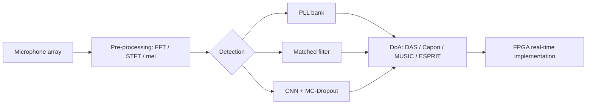
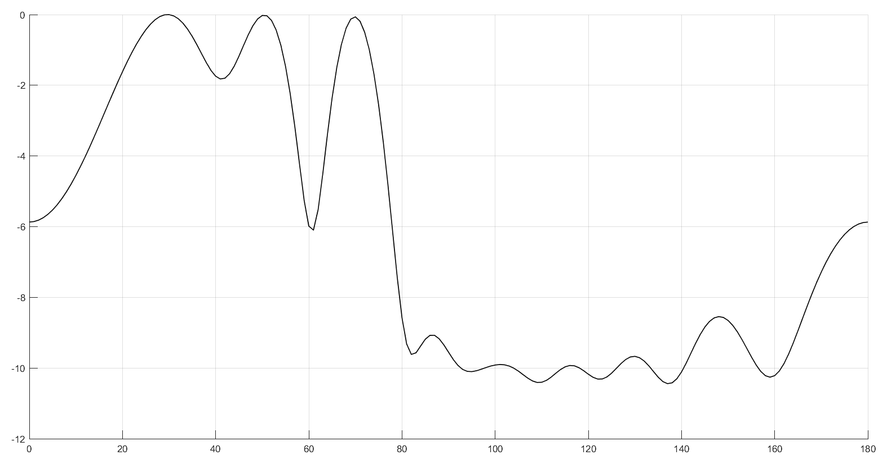
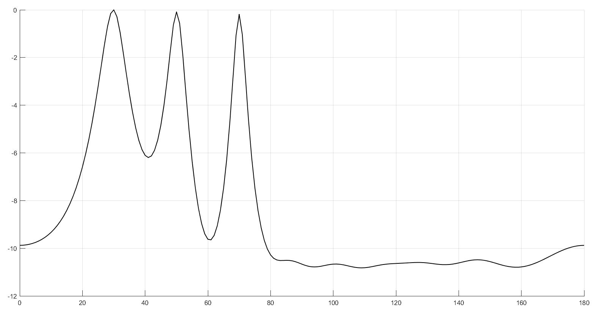
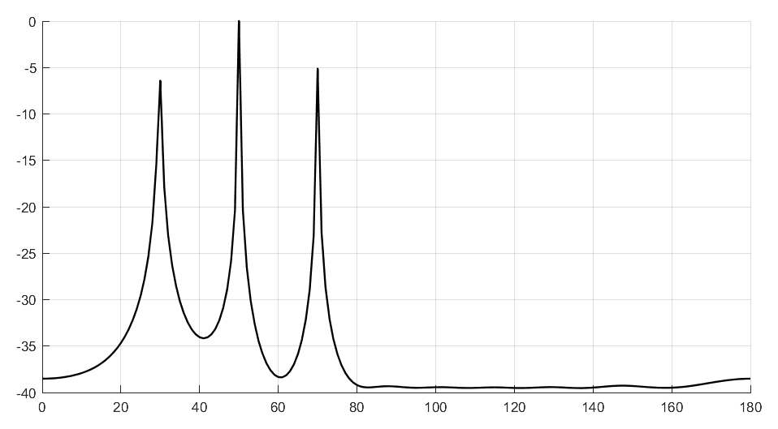
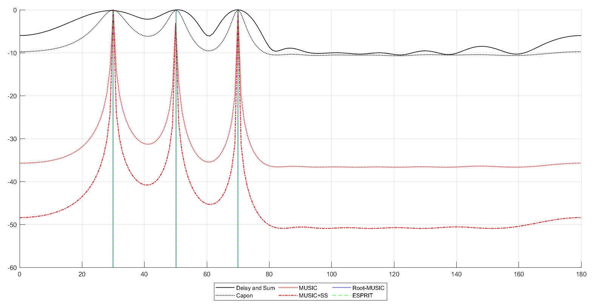
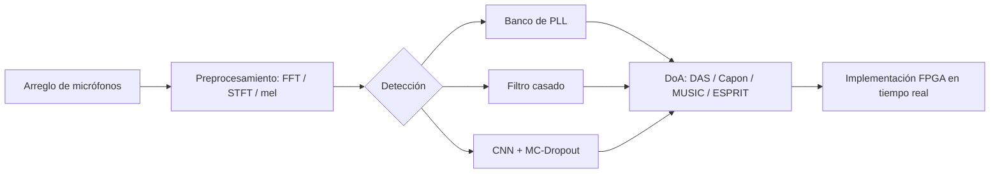

<p align="center"></p>

<p align="center">     </p>
<p align="center"><a href="#english">English</a> · <a href="#español">Español</a></p>

<h1 align="center">Acoustic Detection and Localization of Mosquitoes: Classical DSP to Hybrid FPGA/Deep-Learning Pipelines</h1>

## English

> **Status: on hold.** Personal research project started to find practical ways to detect and count mosquitoes by sound. It is paused; part of the original files and progress were lost, so this repository keeps the literature study and the simulations that survived.

### Overview
Mosquitoes transmit diseases such as dengue, Zika and malaria, and acoustic monitoring is a low-cost, non-invasive way to detect and track them. This independent study (IEEEtran, 13 pages, written in Spanish) traces the path from classical signal processing to hybrid pipelines: phase-locked loops and matched filters for detection, direction-of-arrival (DoA) estimation for localization, convolutional and Bayesian neural networks for robustness to noise, and FPGA accelerators as the route to real-time, on-board deployment (drones, IoT nodes). The contribution is a decision-oriented synthesis: how to choose a technology according to the operational goal (surveillance vs. interception), the acoustic conditions and the computational budget.

📄 Technical report: [`docs/mosquito-acoustic-detection-study.pdf`](docs/mosquito-acoustic-detection-study.pdf) (Spanish)

### Recovered implementation history: "Libélula" (2025)
Before this literature and simulation study, the project had a hands-on phase code-named *Libélula*: data-processing workflows built in KNIME around the HumBugDB mosquito-flight-tone dataset, and a modernized version of the HumBugDB CNN (Kiskin et al.). From the surviving report, that phase:
- ported the reference CNN (64×64 mel-spectrogram input, four convolutional stages, 128-unit dense layer, two-class softmax) from TensorFlow 1.14 / Keras 2.2.4 to TensorFlow 2.19 / Keras 3.9;
- made the custom dropout layer serializable, added safe model loading and the `.keras` format, and enabled dynamic GPU memory growth;
- cut training time from 14–17 min per epoch on CPU to about 1.5 min per epoch on GPU.

The KNIME workflows and the migrated code were lost; only the report survives, so no classification metrics are claimed here.

### What the study covers
| Topic | Content |
|-------|---------|
| PLL banks | Second-order PLL structure and linear model; banks of PLLs for tracking tonal wing-beat components |
| Matched filters | Matched filtering of a noisy linear-FM chirp, windowing (Taylor) to reduce sidelobes |
| DoA estimation | Plane-wave and sensor-array model; delay-and-sum (DAS), Capon/MVDR, MUSIC (with spatial smoothing), ESPRIT |
| Deep learning | FFT, STFT and mel-spectrogram front-ends; CNNs on HumBugDB; Bayesian inference with MC-Dropout; combining DL with DoA |
| FPGA acceleration | Parallelism and resource trade-offs for real-time inference on low-power embedded platforms |

### Pipeline


### Repository layout
```
report/   LaTeX sources (main.tex + one file per section) and fig/
docs/     Compiled report (PDF) and banner
```

### Getting started
Build the report from `report/` with a TeX distribution that includes IEEEtran (e.g. MiKTeX or TeX Live): `pdflatex main.tex` (run twice). The bibliography is embedded in `biblio.tex`.

### Results
Delay-and-sum, Capon, MUSIC and a combined comparison, simulated for three sources at 30°, 50° and 70°, SNR 5 dB and a 10-sensor uniform linear array with normalized spacing 0.5.

<table><tr>
<td align="center" width="50%"><br><sub>Delay-and-sum spatial spectrum (dB vs. angle, °)</sub></td>
<td align="center" width="50%"><br><sub>Capon (MVDR) spatial spectrum (dB vs. angle, °)</sub></td>
</tr><tr>
<td align="center" width="50%"><br><sub>MUSIC pseudo-spectrum (dB vs. angle, °)</sub></td>
<td align="center" width="50%"><br><sub>DAS, Capon, MUSIC, MUSIC+SS, Root-MUSIC and ESPRIT compared</sub></td>
</tr></table>

Only the author's own simulation figures are shown here. Other figures in the report are reproduced from the cited sources and belong to them.

### Author
Elías David Álvarez Martínez, Electronics Engineering, Universidad Católica "Nuestra Señora de la Asunción" (Paraguay), 2025.

### License
Text and the author's own figures: CC BY 4.0 (see `LICENSE`). Figures reproduced from cited literature remain the property of their sources. Code, if added: MIT.

## Español

> **Estado: en pausa.** Proyecto personal de investigación para encontrar formas prácticas de detectar y contar mosquitos por sonido. Quedó congelado y se perdieron parte de los archivos y avances; este repositorio conserva el estudio bibliográfico y las simulaciones que sobrevivieron.


### Descripción
Los mosquitos transmiten enfermedades como dengue, zika y malaria, y el monitoreo acústico es una alternativa de bajo costo y no invasiva para detectarlos y seguirlos. Este estudio independiente (IEEEtran, 13 páginas, en español) recorre el camino desde el procesamiento de señales clásico hasta pipelines híbridos: PLL y filtros casados para detección, estimación de dirección de arribo (DoA) para localización, redes convolucionales y bayesianas para ganar robustez ante el ruido, y aceleradores FPGA como vía hacia la implementación en tiempo real a bordo (drones, nodos IoT). El aporte es una síntesis orientada a decisiones: criterios para elegir tecnología según el objetivo operativo (vigilancia vs. intercepción), las condiciones acústicas y el presupuesto computacional.

📄 Informe técnico: [`docs/mosquito-acoustic-detection-study.pdf`](docs/mosquito-acoustic-detection-study.pdf) (español)

### Historia recuperada: "Libélula" (2025)
Antes de este estudio bibliográfico y de simulación, el proyecto tuvo una etapa práctica con el nombre clave *Libélula*: flujos de procesamiento en KNIME sobre el conjunto de tonos de vuelo de mosquitos HumBugDB y una versión modernizada de la CNN de HumBugDB (Kiskin et al.). Según el informe que se conserva, esa etapa:
- migró la CNN de referencia (entrada de espectrograma mel de 64×64, cuatro etapas convolucionales, capa densa de 128 unidades, softmax de dos clases) de TensorFlow 1.14 / Keras 2.2.4 a TensorFlow 2.19 / Keras 3.9;
- hizo serializable la capa dropout personalizada, agregó carga segura del modelo y el formato `.keras`, y habilitó el crecimiento dinámico de la memoria de GPU;
- redujo el tiempo de entrenamiento de 14 a 17 min por época en CPU a aproximadamente 1,5 min por época en GPU.

Los flujos de KNIME y el código migrado se perdieron; solo se conserva el informe, por lo que aquí no se presentan métricas de clasificación.

### Qué cubre el estudio
| Tema | Contenido |
|-------|---------|
| Bancos de PLL | Estructura y modelo lineal de una PLL de segundo orden; bancos de PLL para seguir componentes tonales del batido de alas |
| Filtros casados | Filtrado casado de un chirp FM lineal ruidoso, aplicación de ventana (Taylor) para reducir lóbulos laterales |
| Estimación DoA | Modelo de onda plana y arreglo de sensores; delay-and-sum (DAS), Capon/MVDR, MUSIC (con suavizado espacial), ESPRIT |
| Aprendizaje profundo | Front-ends FFT, STFT y espectrograma mel; CNN sobre HumBugDB; inferencia bayesiana con MC-Dropout; combinación de DL con DoA |
| Aceleración FPGA | Paralelismo y compromisos de recursos para inferencia en tiempo real sobre plataformas embebidas de bajo consumo |

### Pipeline


### Estructura del repositorio
```
report/   Fuentes LaTeX (main.tex + un archivo por sección) y fig/
docs/     Informe compilado (PDF) y banner
```

### Primeros pasos
Compilar el informe desde `report/` con una distribución TeX que incluya IEEEtran (por ejemplo, MiKTeX o TeX Live): `pdflatex main.tex` (ejecutar dos veces). La bibliografía está incorporada en `biblio.tex`.

### Resultados
Delay-and-sum, Capon, MUSIC y una comparación combinada, simulados para tres fuentes en 30°, 50° y 70°, SNR 5 dB y un arreglo lineal uniforme de 10 sensores con espaciamiento normalizado 0,5.

<table><tr>
<td align="center" width="50%"><br><sub>Espectro espacial delay-and-sum (dB frente a ángulo, °)</sub></td>
<td align="center" width="50%"><br><sub>Espectro espacial Capon (MVDR) (dB frente a ángulo, °)</sub></td>
</tr><tr>
<td align="center" width="50%"><br><sub>Pseudoespectro MUSIC (dB frente a ángulo, °)</sub></td>
<td align="center" width="50%"><br><sub>Comparación de DAS, Capon, MUSIC, MUSIC+SS, Root-MUSIC y ESPRIT</sub></td>
</tr></table>

Aquí solo se muestran las figuras de simulación propias del autor. Las demás figuras del informe se reproducen de las fuentes citadas y pertenecen a ellas.

### Autor
Elías David Álvarez Martínez, Ingeniería Electrónica, Universidad Católica "Nuestra Señora de la Asunción" (Paraguay), 2025.

### Licencia
Texto y figuras propias: CC BY 4.0 (ver `LICENSE`). Las figuras reproducidas de la bibliografía pertenecen a sus fuentes. Código, si se agrega: MIT.
