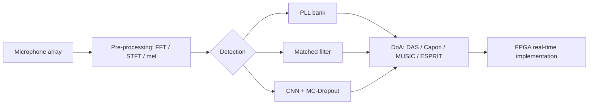
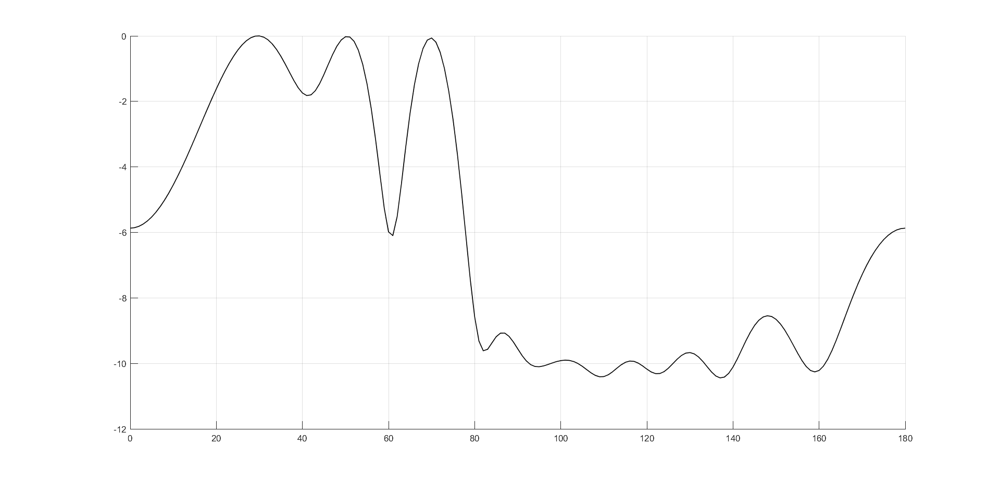
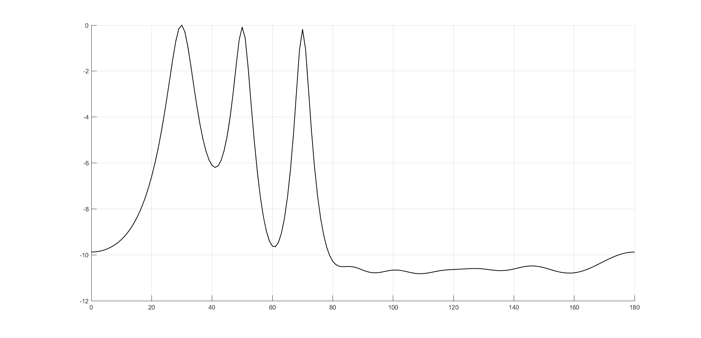
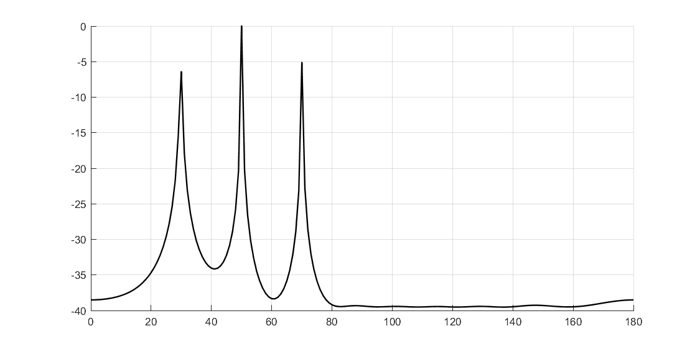
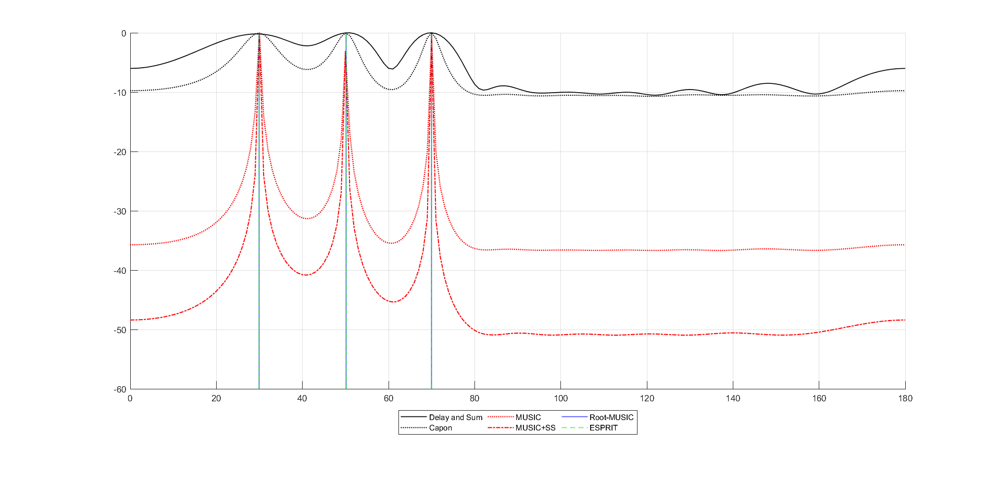

<p align="center"></p>

<p align="center">     </p>
<p align="center"><a href="#english">English</a> · <a href="#español">Español</a></p>

<h1 align="center">Acoustic Detection and Localization of Mosquitoes: Classical DSP to Hybrid FPGA/Deep-Learning Pipelines</h1>

## English

> **Status: on hold.** Personal research project started to find practical ways to detect and count mosquitoes by sound. It is paused; part of the original files and progress were lost, so this repository keeps the literature study and the simulations that survived.

### Overview
Mosquitoes transmit diseases such as dengue, Zika and malaria, and acoustic monitoring is a low-cost, non-invasive way to detect and track them. This independent study (IEEEtran, 13 pages, written in Spanish) traces the path from classical signal processing to hybrid pipelines: phase-locked loops and matched filters for detection, direction-of-arrival (DoA) estimation for localization, convolutional and Bayesian neural networks for robustness to noise, and FPGA accelerators as the route to real-time, on-board deployment (drones, IoT nodes). The contribution is a decision-oriented synthesis: how to choose a technology according to the operational goal (surveillance vs. interception), the acoustic conditions and the computational budget.

📄 Technical report: [`docs/mosquito-acoustic-detection-study.pdf`](docs/mosquito-acoustic-detection-study.pdf) (Spanish)

### What the study covers
| Topic | Content |
|-------|---------|
| PLL banks | Second-order PLL structure and linear model; banks of PLLs for tracking tonal wing-beat components |
| Matched filters | Matched filtering of a noisy linear-FM chirp, windowing (Taylor) to reduce sidelobes |
| DoA estimation | Plane-wave and sensor-array model; delay-and-sum (DAS), Capon/MVDR, MUSIC (with spatial smoothing), ESPRIT |
| Deep learning | FFT, STFT and mel-spectrogram front-ends; CNNs on HumBugDB; Bayesian inference with MC-Dropout; combining DL with DoA |
| FPGA acceleration | Parallelism and resource trade-offs for real-time inference on low-power embedded platforms |

### Pipeline


### Repository layout
```
report/   LaTeX sources (main.tex + one file per section) and fig/
docs/     Compiled report (PDF) and banner
```

### Getting started
Build the report from `report/` with a TeX distribution that includes IEEEtran (e.g. MiKTeX or TeX Live): `pdflatex main.tex` (run twice). The bibliography is embedded in `biblio.tex`.

### Results
Delay-and-sum, Capon, MUSIC and a combined comparison, simulated for three sources at 30°, 50° and 70°, SNR 5 dB and a 10-sensor uniform linear array with normalized spacing 0.5.

<table><tr>
<td align="center" width="50%"><br><sub>Delay-and-sum spatial spectrum</sub></td>
<td align="center" width="50%"><br><sub>Capon (MVDR) spatial spectrum</sub></td>
</tr><tr>
<td align="center" width="50%"><br><sub>MUSIC spatial spectrum</sub></td>
<td align="center" width="50%"><br><sub>DAS, Capon, MUSIC, MUSIC+SS, Root-MUSIC and ESPRIT compared</sub></td>
</tr></table>

Only the author's own simulation figures are shown here. Other figures in the report are reproduced from the cited sources and belong to them.

### Author
Elías David Álvarez Martínez, Electronics Engineering, Universidad Católica "Nuestra Señora de la Asunción" (Paraguay), 2025.

### License
Text and the author's own figures: CC BY 4.0 (see `LICENSE`). Figures reproduced from cited literature remain the property of their sources. Code, if added: MIT.

## Español

> **Estado: en pausa.** Proyecto personal de investigación para encontrar formas prácticas de detectar y contar mosquitos por sonido. Quedó congelado y se perdieron parte de los archivos y avances; este repositorio conserva el estudio bibliográfico y las simulaciones que sobrevivieron.


### Descripción
Los mosquitos transmiten enfermedades como dengue, zika y malaria, y el monitoreo acústico es una alternativa de bajo costo y no invasiva para detectarlos y seguirlos. Esta revisión de autoría individual (IEEEtran, 13 páginas, en español) recorre el camino desde el procesamiento de señales clásico hasta pipelines híbridos: PLL y filtros casados para detección, estimación de dirección de arribo (DoA) para localización, redes convolucionales y bayesianas para ganar robustez ante el ruido, y aceleradores FPGA como vía hacia la implementación en tiempo real a bordo (drones, nodos IoT). El aporte es una síntesis orientada a decisiones: criterios para elegir tecnología según el objetivo operativo (vigilancia vs. intercepción), las condiciones acústicas y el presupuesto computacional.

📄 Documento: [`docs/mosquito-acoustic-detection-study.pdf`](docs/mosquito-acoustic-detection-study.pdf)

### Contenido
PLL, filtros casados, DoA (delay-and-sum, Capon/MVDR, MUSIC, ESPRIT), CNN sobre HumBugDB con inferencia bayesiana por MC-Dropout y aceleración en FPGA. Ver la tabla, el diagrama y el árbol de la sección en inglés.

### Resultados
Las figuras de arriba son simulaciones propias (tres fuentes en 30°, 50° y 70°, SNR 5 dB, arreglo lineal uniforme de 10 sensores con espaciamiento normalizado 0,5). Las demás figuras del informe están reproducidas de las fuentes citadas y pertenecen a ellas.

### Compilación
Desde `report/`: `pdflatex main.tex` (dos veces). La bibliografía está en `biblio.tex`.

### Autor
Elías David Álvarez Martínez, Ingeniería Electrónica, Universidad Católica "Nuestra Señora de la Asunción" (Paraguay), 2025.

### Licencia
Texto y figuras propias: CC BY 4.0 (ver `LICENSE`). Las figuras reproducidas de la bibliografía pertenecen a sus fuentes. Código, si se agrega: MIT.
